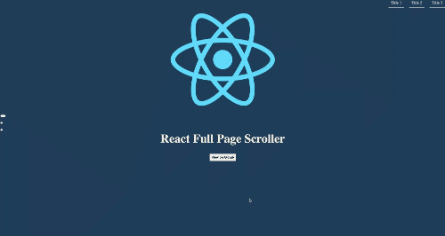

# react-full-page-scroller

> A react module for full page scroll

[](https://www.npmjs.com/package/react-full-page-scroller) [](https://standardjs.com)

## Contributing

See the [Copilot instructions](.github/copilot-instructions.md) and [contributor workflow](.github/skills/contributor-workflow/SKILL.md) for development, testing, issue and pull request, and release guidance.

## Install

```bash
npm install --save react-full-page-scroller
```

The package includes TypeScript declarations for its component props and page navigation items.
React 18.3.1 and React 19 are supported.

## Demo



## Usage

```jsx
import React, { Component } from 'react'

import MyComponent from 'react-full-page-scroller'

class Example extends Component {
  render() {
    return (
      <MyComponent>
        <div>
          <h1>1</h1>
        </div>
        <div>
          <h1>2</h1>
        </div>
        <div>
          <h1>3</h1>
        </div>
      </MyComponent>
    )
  }
}
```

### Props

| Prop Name            | Type            | Required |
| -------------------- | --------------- | -------- |
| pageNav              | `PageNavItem[]` | No       |
| indicatorStyle       | `CSSProperties` | No       |
| indicatorStyleActive | `CSSProperties` | No       |

#### Page Nav Object

You can customize every button in the nav page

| Name      | Type   | Required | Description                             |
| --------- | ------ | -------- | --------------------------------------- |
| id        | number | No       | id for the object.                      |
| title     | string | Yes      | title of the nav button.                |
| className | string | No       | the className of the page nav button.   |
| style     | object | No       | A custom style for the page nav button. |

##### Exemple

```jsx
import React from 'react'

import FullPage from 'react-full-page-scroller'

const PageNavExample = () => {
  const navExample = [
    {
      id: 1,
      title: 'title 1',
      className: 'page-nav-button',
      style: { width: '1rem' }
    },
    {
      id: 2,
      title: 'title 2',
      className: 'page-nav-button',
      style: { width: '1rem' }
    },
    {
      id: 3,
      title: 'title 3',
      className: 'page-nav-button',
      style: { width: '1rem' }
    }
  ]

  return (
    <FullPage pageNav={navExample}>
      <div>
        <h1 className='page-number'>1</h1>
      </div>
      <div>
        <h1 className='page-number'>2</h1>
      </div>
      <div>
        <h1 className='page-number'>3</h1>
      </div>
    </FullPage>
  )
}
```

#### Indicator Style

You can add an indicator by adding the two props indicatorStyle and indicatorStyleActive

| Name                 | Type   | Required | Description                                                    |
| -------------------- | ------ | -------- | -------------------------------------------------------------- |
| indicatorStyle       | object | Yes      | the indicator default style is required to show the indicator. |
| indicatorStyleActive | object | No       | the style of the active indicator.                             |

##### Exemple

```jsx
import React from 'react'

import FullPage from 'react-full-page-scroller'

const IndicatorStyleExample = () => {
  const indicatorStyle = {
    height: '8px',
    width: '8px',
    margin: '10px',
    borderRadius: '4px',
    backgroundColor: 'white',
    transition: 'width 500ms ease'
  }
  const indicatorStyleActive = { width: '20px' }

  return (
    <FullPage
      indicatorStyle={indicatorStyle}
      indicatorStyleActive={indicatorStyleActive}
    >
      <div>
        <h1 className='page-number'>1</h1>
      </div>
      <div>
        <h1 className='page-number'>2</h1>
      </div>
      <div>
        <h1 className='page-number'>3</h1>
      </div>
    </FullPage>
  )
}
```

## Development and testing

See the [modernization and dependency upgrade plan](docs/upgrade-plan.md) for
the proposed upgrade order, compatibility constraints, and acceptance gates.

Development requires Node.js 24.22.2 and npm 11.21.2. Use the checked-in
`.nvmrc` to select Node.js; npm checks both versions through `devEngines`.
These development requirements do not define the Node.js support of the
published browser library. The package does not currently declare a consumer
Node.js engine range.

Install the locked development dependencies with `npm ci`.

Use `feature/*` branches targeting `develop`; promote releases to `master`.
Pull requests and integration-branch pushes run path-aware GitHub Actions checks.
See the [CI/CD guide](docs/ci-cd.md) for the audit, required merge check,
execution scenarios, artifact names, and the unchanged manual deployment process.

```bash
# Run all library unit and integration tests once
npm run test:unit -- --watchAll=false --runInBand

# Include coverage for every library module
npm run test:unit -- --watchAll=false --runInBand --coverage

# Run unit tests, lint and the production build
npm test
```

End-to-end tests (Playwright, real Chromium against the built demo) live in
`e2e/`. Run `npx playwright install chromium` once, then:

```bash
npm run e2e:build   # build library and demo
npm run test:e2e    # run e2e (CI runs the same command)
```

See the [CI/CD guide](docs/ci-cd.md#end-to-end-tests) for details. Agents and
humans should run these after any behavior change.

Tests use the existing Jest/jsdom runner and React DOM test utilities. They cover
child filtering, viewport styling, navigation, indicator updates, scroll direction
and boundaries, scroll locking, lifecycle cleanup and server-side rendering.
Scroll positions and timers are controlled in tests; no real browser scrolling or
one-second waits are needed.

## License

© [Ibrahim Haouari](https://github.com/Ibrahim-ih)
